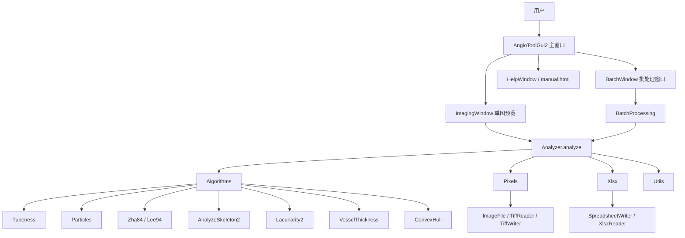
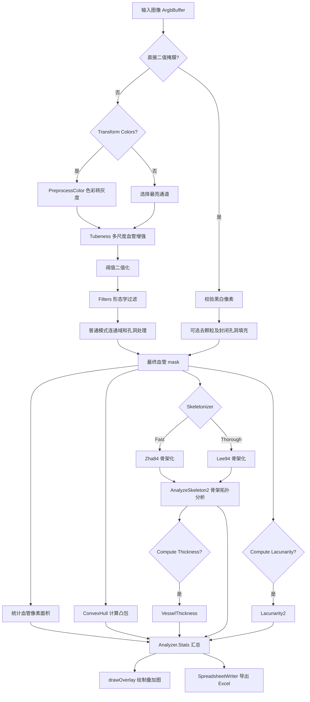

# AngioTool 2.3.2 CLI 扩展

2026-10-26：Astra复审通过后的两阶段扩展，2.3.1提供53参数集中描述表、schema1配置及config命令；2.3.2通过纯 `CliPlan` 统一dry-run与执行的输入枚举/归属/筛选/输出保护，支持多输入、清单和选择导出。显式选择不触碰未选产物，报告记录生效配置、来源、实际输出和未更新文件。GUI继续复用原入口，分析算法不变。细节见 [CLI指南](CLI_CN.md)、[参数参考](CLI_PARAMETERS_CN.md)、[修订实施计划](CLI_EXTENSION_PLAN_CN.md)。以下为历史更新及架构报告。

# AngioTool 2.3.0 CLI 更新

2026-10-26：新增 `Cli` 无界面编排层，在任何桌面初始化前分流带参数启动。CLI 顺序执行并复用 `Analyzer`、参数导入、叠加绘制及 JSON/XLSX 导出，不调用 GUI 批处理入口，不读取用户偏好。无参数仍启动桌面；底层算法与指标定义继承 2.2.3。使用及失败语义见 [CLI 指南](CLI_CN.md)，测试证据见 [验证记录](VALIDATION_CN.md)。以下为继承的 2.2.3 程序报告。

# AngioTool 2.2.3 程序报告

> **2026-10-06：2.2.3 正式版本**：增加 JSON 参数恢复、用户控制的 `Auto update` 开关及 `Apply parameters`。导入恢复分析、颜色与叠加设置，但只填入界面，不更新现有图片或切换自动更新开关。本版取消恢复默认确认框及导入成功信息框，失败提示保留；源码构建默认输出独立 `AngioTool2.2.3.jar`，独立 JAR 的回归及 GUI 验证记录见 [VALIDATION_CN.md](VALIDATION_CN.md)。操作说明见 [用户指南](USER_GUIDE_CN.md#52-参数更新与-json-配置恢复223)。

> **2026-09-12 分形维数更新**：普通/直接二值模式均在最终掩膜上自动执行盒计数分析，输出维数、R²、独立有效性及尺度/计数信息。统计侧栏、单图/批量 Excel 和 JSON 同步接入。具体采样规则、解释边界和验证记录见 [盒计数分形维数](FRACTAL_BOX_COUNT_CN.md)。

> **2026-09-07 UI 更新**：已引入随 JAR 打包的 FlatLaf 3.6.1，并改为单窗口工作台：左侧参数，右侧多图标签、画布与统计侧栏。`ImagingWindow` 保留类名，但现在继承 `JPanel`，不再创建独立图像窗口。保持既有分析、导出和共享参数行为。新增 `UiTheme`、`StatisticsPanel`、UI 冒烟测试及指标对照工具。详细实现、验证与回退边界见 [UI_MODERNIZATION_CN.md](UI_MODERNIZATION_CN.md)；下文旧 UI 描述作为历史架构背景保留。

本文档基于对原始项目和 `D:\CodeProject\AngioTool 2.1` 修复副本的代码阅读整理，目的是为后续修改、维护和新增功能提供整体背景。文档开头的“当前状态与修复记录”优先于历史架构说明。

## 1. 项目概述

当前发布版为 AngioTool 2.2.3。2.2.1 阶段的 XLSX 修复属于历史记录；2.2.2 修正了 8 邻域转角产生的单像素内部连接被误计为 junction 外部支路的问题。受影响数据应使用新版本重新计算 junction 数量和 junction density。最新测试结果及边界见 [当前验证记录](VALIDATION_CN.md)。

当前发布版 AngioTool 2.2.3 是一个 Java 桌面图像分析程序，主要用于眼部扫描、血管造影或 OCT 图像中的血管结构分析。程序从输入图像中识别血管区域，生成带有轮廓、骨架、分支点和凸包的叠加图，并导出结构化统计结果到 Excel。文中提到的 2.0 是上游项目的历史版本背景。

核心用户场景有两个：

- 单张图像分析：打开一张图，调整参数，实时预览结果，保存叠加图或统计表。
- 批量分析：选择一个或多个文件夹，递归处理其中的图像，统一使用当前参数，批量导出 Excel 和可选结果图。

程序可以作为独立桌面程序运行，也可以作为 ImageJ 插件运行。当前代码和 README 都显示，独立模式是主要推荐路径，ImageJ 支持偏实验性。

## 2. 技术栈与工程形态

项目是传统 Java 桌面程序，不使用 Maven、Gradle、Spring 或 JavaFX。

主要技术组成：

- 语言：Java，目标版本 Java 8。
- UI：Swing。
- 图像处理：自研算法为主。
- Excel：自研 `.xlsx` 读写。
- 图片格式：自研 TIFF/NetPBM 读写，其余格式依赖 Java `ImageIO`。
- 构建：Python 脚本 `compile.py`。
- Windows 启动器：`buildexe.py` + `launcher-win32.c`。
- 插件兼容：ImageJ API stub + `IJPlugin.ATPlugin`。

构建产物主要是：

- `AngioTool2.2.3.jar`
- 历史 `AngioTool2-32.exe` / `AngioTool2-64.exe`（`buildexe.py` 尚未适配版本化 JAR，本轮只交付独立 JAR）

## 3. 目录与模块职责

源码主体位于 `source/`：

```text
source/
├── AngioTool/   主程序、GUI、参数、分析调度、批处理
├── Algorithms/  血管增强、骨架化、连通域、厚度、lacunarity 等算法
├── Pixels/      图像读取、写入、ARGB 缓冲区、绘图辅助
├── Utils/       BufferPool、向量容器、并行切片执行器、文件/UI 工具
├── Xlsx/        Excel xlsx 读取和写入
├── IJPlugin/    ImageJ 插件入口
├── images/      UI 图标资源
└── manual.html  内置帮助文档
```

项目根目录中还包括：

- `compile.py`：编译 Java、处理 `.tj` 模板、打包 JAR。
- `buildexe.py`：生成 Windows EXE。
- `launcher-win32.c`：原生 Windows 启动器。
- `plugins.config`：ImageJ 插件注册。
- `stubs/`：ImageJ 相关 stub，保证独立编译。
- `deprecated/`：旧代码，不参与当前主构建。

## 4. 程序入口与启动流程

独立程序入口：

```text
source/AngioTool/AngioTool.java
```

启动流程：

1. `main()` 被调用。
2. 预加载 `Algorithms.Lee94`，主要是提前加载 Lee94 骨架化需要的 lookup table。
3. 进入 Swing EventQueue。
4. 初始化图标、资源、参数偏好。
5. 创建主窗口 `AngioToolGui2`。

ImageJ 插件入口：

```text
source/IJPlugin/ATPlugin.java
```

插件模式会从 ImageJ 当前图像复制像素数据，包装为内部 `ArgbBuffer`，然后复用 AngioTool 的 GUI 和分析流程。

## 5. 模块关系图



## 6. 核心分析管线

核心分析调度类：

```text
source/AngioTool/Analyzer.java
```

`Analyzer.analyze()` 是整个系统最重要的方法，单图分析和批处理最终都会进入这里。`prepareMask()` 根据 `shouldUseBinaryMask` 选择普通增强或直接掩膜路径。



普通模式分析管线步骤（第 2–7 步在二值模式下由像素校验及可选清理替代）：

1. 输入图像进入 `ArgbBuffer`。
2. 如果启用颜色变换，调用 `PreprocessColor` 将彩色图转换为适合血管识别的灰度强度图。
3. 如果未启用颜色变换，则取输入图像中最亮通道作为分析基础。
4. 调用 `Tubeness` 做多尺度血管增强。
5. 根据用户设置的 low/high intensity 阈值进行二值化。
6. 使用 `Filters` 做形态学过滤，清理噪声。
7. 调用 `Particles` 做连通域分析、小颗粒移除、孔洞填充和 void 处理。
8. 统计血管前景像素面积。
9. 调用 `Lacunarity2` 计算 lacunarity，前提是用户开启该选项。
10. 调用 `ConvexHull` 计算组织/血管区域凸包面积。
11. 根据参数选择骨架化算法：快速 `Zha84` 或彻底 `Lee94`。
12. 调用 `AnalyzeSkeleton2` 分析骨架拓扑，得到分支、端点、junction 等。
13. 如开启厚度计算，调用 `VesselThickness` 估算血管厚度。
14. 汇总为 `Analyzer.Stats`。
15. 可调用 `Analyzer.drawOverlay()` 绘制结果叠加图。

### 6.1 二值模式与设置归属

直接模式接受黑底白色前景的 0/255 或 0/1 灰度像素；其他像素报错并提供坐标，不做隐式阈值或反色。单图与批处理统一通过 `effectiveResizeFactor()` 禁用输入缩放。颜色变换、Tubeness、强度阈值、闭运算及高级清理被绕过；骨架算法与指标定义沿用现有实现。

二值去颗粒和填洞默认关闭，由 `binaryRemoveSmallParticles`、`binarySmallParticleRadius`、`binaryFillHoles`、`binaryHoleRadius` 独立记录，不能把普通模式的同名控件参数当作本模式的有效设置。先去颗粒，再重新标记连通域并调用 `Particles.fillEnclosedHoles()`；填洞排除图像边界连通背景。此规则仍可能填掉面积阈值内的真实网孔，需人工复核。

## 7. 关键算法模块

### `Algorithms/Tubeness.java`

用于血管增强。它对输入图像进行多尺度高斯平滑，并基于 Hessian 特征值增强管状结构。用户在 UI 中配置的 `Vessel Diameters list` 会影响这一阶段的 sigma 列表。

### `Algorithms/Zha84.java`

快速骨架化算法，对应 UI 中 `Fast (Zha84)`。优点是速度快，适合批量处理；缺点是结果质量可能不如 Lee94。

### `Algorithms/Lee94.java`

更彻底的骨架化算法，对应 UI 中 `Thorough (Lee94)`。启动时会预加载 lookup table，构建时也会打包 `lee94-simple-points.bin`。算法质量更好，但更慢、资源占用更高。

### `Algorithms/AnalyzeSkeleton2.java`

对骨架结果做拓扑分析，识别：

- end points
- junction voxels
- slab voxels
- branch length
- tree count
- isolated junctions

这些结果会直接进入统计表和 overlay 绘制。

### `Algorithms/Particles.java`

负责二值图中的连通域识别、颗粒过滤、孔洞填充。`Max Hole Level`、`Min Boxness`、`Min Length : Area` 等 UI 参数主要影响这里。

### `Algorithms/Lacunarity2.java`

负责 lacunarity 分析。它基于多尺度 box counting，输出 E/F 两类 lacunarity 的 medial、mean 和 gradient。

### `Algorithms/VesselThickness.java`

基于距离变换估算血管厚度，最终结果进入 `Average Vessel Diameter`。

## 8. UI 架构

主 UI 类：

```text
source/AngioTool/AngioToolGui2.java
```

它负责展示和收集所有分析参数，包括：

- lacunarity 开关
- thickness 开关
- skeletonizer 类型
- max skeleton steps
- resize inputs
- measurement scale
- remove particles
- fill holes
- max hole level
- min boxness
- min length : area
- transform colors
- vessel diameters
- vessel intensity range
- overlay 样式

主窗口内的单图分析标签：

```text
source/AngioTool/ImagingWindow.java
```

职责包括：

- 显示 Original / Final mask / Skeleton overlay 三种视图。
- 支持缩放和平移。
- 分析参数变化时重新调度分析任务；仅切换查看视图不重算。
- 保存结果图。
- 保存单图统计结果到 Excel。

`ImagingDisplay.drawingImage` 始终保存可导出的叠加结果；`previewImage` 为原图或最终掩膜预览，`maskSnapshot` 保存分析完成时的掩膜副本，避免下一轮计算复用缓冲区造成显示中间态。视图选择归各图像标签所有，不属于分析参数，不改变保存图像或 ImageJ 提交结果。关闭标签时释放相关缓冲区。

批处理窗口：

```text
source/AngioTool/BatchWindow.java
```

职责包括：

- 选择输入文件夹。
- 选择 Excel 输出文件。
- 设置结果图输出方式。
- 设置结果图格式。
- 设置 worker 数量。
- 展示批处理进度。
- 触发 `BatchProcessing.doBatchAnalysis()`。

帮助窗口：

```text
source/AngioTool/HelpWindow.java
source/manual.html
```

`manual.html` 是较完整的用户手册，也是理解功能语义的重要资料。

## 9. 批处理与并发模型

批处理核心类：

```text
source/AngioTool/BatchProcessing.java
```

工作方式：

1. 从 `BatchParameters.inputImagePaths` 读取一个或多个输入路径。
2. 递归扫描所有子目录。
3. 跳过 `.txt`、`.zip`、`.xls`、`.xlsx` 等非图像文件。
4. 跳过文件名尾部类似 `result`、`tubeness`、`thresholded`、`filtered`、`overlay` 的输出结果图，避免重复处理。
5. 为每张图创建 `AnalysisInput`。
6. 根据 `workerCount` 启动多个 worker。
7. 每个 worker 独立加载图像、执行 `Analyzer.analyze()`、可选保存结果图。
8. 主线程从队列取回结果，写入 Excel。
9. UI 通过 `IProgressToken` 回调更新进度。

并发资源主要依赖：

```text
Analyzer.threadPool
ImagingWindow.threadPool
Utils.ISliceRunner
各类 BufferPool
```

这说明项目比较重视性能，但也意味着后续修改时需要注意线程安全和内存释放。

## 10. 参数与偏好保存

分析参数类：

```text
source/AngioTool/AnalyzerParameters.java
```

批处理参数类：

```text
source/AngioTool/BatchParameters.java
```

偏好保存类：

```text
source/AngioTool/ATPreferences.java
```

偏好文件位置：

```text
%USERPROFILE%\AngioTool2\AT_Prefs.txt
%USERPROFILE%\AngioTool2\AT_BatchPrefs.txt
```

`ATPreferences` 使用反射遍历参数对象字段，并保存为文本。优点是新增字段时较容易自动纳入保存；缺点是字段改名、类型变更时需要注意兼容性。

## 11. 图像 I/O 与数据结构

核心图像类：

```text
source/Pixels/ArgbBuffer.java
source/Pixels/ImageFile.java
```

`ImageFile` 支持：

- TIFF / TIF
- NetPBM，例如 PPM/PGM
- Java ImageIO 支持的格式，如 PNG、JPG、GIF、BMP

内部分析基本围绕 ARGB int 数组、byte mask、float buffer 展开。大量使用 `Utils` 中的 BufferPool，例如 `IntBufferPool`、`FloatBufferPool`、`ByteBufferPool`，以减少大图分析时的内存分配和 GC 压力。

## 12. Excel 导出

Excel 模块：

```text
source/Xlsx/SpreadsheetWriter.java
source/Xlsx/XlsxReader.java
```

程序没有使用 Apache POI，而是自研生成 `.xlsx` ZIP 包和 XML 内容。导出字段包括：

- 图像名称、路径、宽高
- 日期、时间
- 分析参数
- explant area
- vessel area
- vessel percentage area
- junction count
- junction density
- total vessel length
- average vessel length
- endpoint count
- average vessel diameter
- E/F lacunarity 指标

批处理会把设置和结果写入 Excel；单图也可以把当前结果追加到表格中。

## 13. 构建与部署

主构建脚本：

```text
compile.py
```

流程：

1. 检查 `javac`。
2. 检查或生成 `lee94-simple-points.bin`。
3. 处理 `source/` 中的 `.tj` 模板，生成 Java 文件。
4. 收集 Java 源文件和 stub。
5. 使用 `javac --release=8` 编译到 `build/`。
6. 打包资源、class 文件、lookup table 和 `plugins.config` 到当前发布产物 `AngioTool2.2.3.jar`。

Windows EXE 构建：

```text
buildexe.py
launcher-win32.c
```

大致流程：

1. 当前 `buildexe.py` 仍硬编码读取旧的 `AngioTool2.jar`，尚未适配版本化 JAR；本轮不以该脚本生成或发布 EXE。
2. 生成 C 头文件，把 JAR 嵌入为字节数组。
3. 使用 TCC 编译 32 位和 64 位启动器。
4. 启动器负责找到 Java、释放或加载 JAR、调用 JVM。

## 14. 后续修改建议

### 新增分析参数

修改 `AnalyzerParameters`，再修改 `AngioToolGui2.buildAnalyzerParamsFromUi()` 和 UI 控件初始化。如果需要保存，确认 `ATPreferences` 能正确处理该类型。

### 新增分析算法

在 `Algorithms/` 下新增类，然后在 `Analyzer.analyze()` 中插入对应阶段。建议尽量保持输入输出为明确的 buffer，避免直接依赖 Swing UI。

### 新增导出字段

修改 `Analyzer.Stats`，在 `Analyzer.analyze()` 中赋值，再修改：

- `createWriterWithNewSheet()`
- `writeResultToSheet()`
- `createBatchWriterWithNewSheet()`
- `writeBatchResultToSheet()`

### 新增 overlay 绘制

修改 `Analyzer.drawOverlay()`，并在 `AngioToolGui2` 增加颜色、尺寸、开关等 UI 参数。

### 新增批处理选项

修改 `BatchParameters`、`BatchWindow.buildBatchParamsFromUi()`、`BatchProcessing.doBatchAnalysis()`。

### 新增图像格式

优先在 `Pixels/ImageFile.java` 扩展读取/保存逻辑。如果 Java `ImageIO` 已支持，则可能只需要增加文件过滤器或格式处理。

## 15. 风险与注意点

### `Analyzer.analyze()` 是高耦合核心

目前分析管线集中在一个方法中，修改时容易影响多个指标。后续如果改动较大，建议先为每个阶段建立清晰输入输出说明。

### BufferPool 带来性能，也带来生命周期风险

很多数组需要手动 release。新增算法时必须明确谁申请、谁释放，避免内存泄漏或复用错误。

### 并发场景需要谨慎

单图预览、批处理、内部 slice runner 都会使用线程池。新增共享状态时要避免跨线程复用可变对象。

### Excel 写入是自研实现

对复杂 Excel 特性支持有限。如果后续要加入样式、公式、多语言、图表，当前实现可能需要扩展较多。

### 偏好保存依赖字段名和类型

改名或类型变更可能导致旧偏好文件解析失败。新增参数应考虑默认值和兼容策略。

### ImageJ 插件模式不是主路径

修改图像输入输出或 GUI 生命周期时，需要额外验证 ImageJ 插件模式是否仍可用。

### 构建流程非标准

没有 Maven/Gradle，依赖、资源、模板生成都由 `compile.py` 控制。后续引入外部库或自动化测试时，可能需要先整理构建系统。

## 16. 建议的下一步工作

### P0

- 确认当前项目能否在本机完整编译并运行。
- 建立一组固定测试图像，用于验证修改前后结果是否一致。
- 为 `Analyzer.analyze()` 写一份更细的阶段说明或函数级文档。

### P1

- 梳理 `Analyzer.Stats` 与 Excel 字段的对应关系，形成字段字典。
- 为批处理建立小规模回归测试：输入几张图片，检查输出 Excel 和结果图是否生成。
- 明确 `BufferPool` 使用规范，避免后续开发误用。

### P2

- 考虑把核心分析管线拆成更小的阶段函数，降低未来功能插入成本。
- 考虑引入标准构建工具或至少补充构建说明。
- 如果后续要做 UI 大改，再单独梳理 Swing 界面布局和事件流。

## 17. 快速定位索引

后续开发时可以优先查看以下文件：

| 目标 | 文件 |
| --- | --- |
| 程序入口 | `source/AngioTool/AngioTool.java` |
| ImageJ 插件入口 | `source/IJPlugin/ATPlugin.java` |
| 主界面 | `source/AngioTool/AngioToolGui2.java` |
| 单图分析窗口 | `source/AngioTool/ImagingWindow.java` |
| 批处理窗口 | `source/AngioTool/BatchWindow.java` |
| 批处理逻辑 | `source/AngioTool/BatchProcessing.java` |
| 核心分析管线 | `source/AngioTool/Analyzer.java` |
| 分析参数 | `source/AngioTool/AnalyzerParameters.java` |
| 批处理参数 | `source/AngioTool/BatchParameters.java` |
| 偏好保存 | `source/AngioTool/ATPreferences.java` |
| 血管增强 | `source/Algorithms/Tubeness.java` |
| 快速骨架化 | `source/Algorithms/Zha84.java` |
| 高质量骨架化 | `source/Algorithms/Lee94.java` |
| 骨架拓扑分析 | `source/Algorithms/AnalyzeSkeleton2.java` |
| 连通域和孔洞处理 | `source/Algorithms/Particles.java` |
| Lacunarity | `source/Algorithms/Lacunarity2.java` |
| 血管厚度 | `source/Algorithms/VesselThickness.java` |
| 图像 I/O | `source/Pixels/ImageFile.java` |
| Excel 导出 | `source/Xlsx/SpreadsheetWriter.java` |
| 构建 JAR | `compile.py` |
| 构建 EXE | `buildexe.py` |
# AngioTool 2.2.2 当前状态与修复记录

更新时间：2026-09-16

## 1. 版本定位

本目录最初从 `D:\CodeProject\AngioTool` 独立复制为 2.1 修复副本，现开发至 2.2.2。原版目录保留用于对照和继续使用，本目录的修改不会回写原目录。

当前版本仍采用 Java 8、Swing GUI 和原有图像分析算法，重点是提高结果安全性、可解释性和回归验证能力，而不是立即重写为其他语言。

## 2. 当前分析流程

普通模式的主要图像分析流程如下：

```text
输入图像
  -> 颜色/亮度预处理
  -> 多尺度 Gaussian + Hessian Tubeness
  -> 强度阈值
  -> 固定 3x3 形态学闭运算两次
  -> 连通域、孔洞和小颗粒处理
  -> 二值血管 mask
  -> mask 面积与凸包面积
  -> Zha84 或 Lee94 骨架化
  -> 骨架拓扑分析
  -> 长度、端点、junction、厚度、lacunarity
  -> XLSX / JSON / overlay 输出
```

直接二值模式的前半段替换为：`原始尺寸图像 → 黑白像素校验 → 可选去小颗粒 → 可选封闭孔洞填充 → 最终 mask`。后续面积、骨架与统计阶段共用原实现；参数、导出与验证细节见本文第 6.1 节及 [UI 变更记录](UI_MODERNIZATION_CN.md)。

## 3. 已完成修复

### 3.1 空结果和异常尺寸

- 空 mask 不再导致面积比例和 junction density 输出 `NaN` 或 `Infinity`。
- 空骨架不再被强制解释为一棵连通树。
- lacunarity 对空图、过小 ROI 和非法参数安全返回。
- Tubeness 支持 `1x1`、`1xN` 和 `Nx1` 图像，不再触发镜像边界除零。
- Tubeness 会跳过 NaN、Infinity 和负 sigma。

### 3.2 统计定义

- 新增 `Average Segment Length`，即总骨架长度除以分支段数量。
- 保留旧的 `Average Vessels Length`，但其真实含义是每棵连通树的平均总长度。
- 空或退化分割结果现在包含：
  - `valid`
  - `invalidReason`

- 骨架化现在记录 `skeletonConverged`；统计侧栏显示 `Converged` 或 `Step limit reached`，JSON 与 XLSX 也输出该状态。达到步数上限而未收敛时，依赖收敛的骨架剪枝会被跳过。

### 3.3 结果可追踪性

JSON metrics 新增或明确记录：

- `valid`
- `invalidReason`
- `areaDenominator`
- `morphology`
- `averageSegmentLength`
- `skeletonPixelCount`
- `isolatedSkeletonPixelCount`

当前值：

```text
areaDenominator = vessel-mask-convex-hull
morphology = 3x3-closing-twice
```

### 3.4 颜色预处理

- 目标颜色和排除颜色过近时，参数验证会拒绝。
- 颜色重映射内部也增加了最小 hue 分离保护。
- 单图统计区域会显示无效分析原因。

### 3.5 回归验证

测试文件：

`benchmarks/AngioTool/AnalysisRegressionTest.java`

目前覆盖：

- 空图 lacunarity；
- 小于最小 box 尺寸的 ROI；
- 单条直线骨架；
- 简单分叉骨架；
- 1x1 Tubeness 输入。

历史验证结果（2026-09-07，非本轮复测）：

```text
AnalysisRegressionTest: PASS
```

## 4. 当前指标的真实含义

### Vessels Area

最终二值血管 mask 的前景像素面积，不等于原始图像中的真实血管面积。

### Explant Area

当前实际是所有血管前景像素的凸包面积。它不是严格意义上的组织 ROI 面积，可能包含凹陷、空洞和血管区域之间的空白。

### Vessels Percentage Area

```text
vessel mask area / vessel-mask convex hull area
```

只有在凸包能够合理代表组织区域时，才适合解释为组织内血管比例。

### Average Vessels Length

当前为：

```text
total skeleton length / connected tree count
```

它是平均连通树长度，不是平均分支段长度。

### Average Segment Length

当前为：

```text
total skeleton length / skeleton segment count
```

这是更接近“平均分支长度”的字段。

### Average Vessel Diameter

程序在骨架 slab 点计算到最近背景的距离，乘以 2 后取中位数。因此它更准确的名称是：

```text
median local mask diameter
```

不是严格的横截面平均直径。

### Vessel Diameters

该参数实际控制 Tubeness 的 Gaussian/Hessian sigma 尺度，不是程序最终测得的直径。

## 5. 尚未完成的问题

以下问题仍需真实标注数据或合成几何数据验证：

1. 凸包面积作为组织面积分母可能造成系统性高估。
2. 固定形态学闭运算可能连接相邻血管或删除细小结构。
3. 多 sigma Tubeness 的跨尺度响应仍缺少充分的可比性验证。
4. Zha84 和 Lee94 的骨架结果尚未完成一致性校准。
5. junction 识别和合并对像素连接方式敏感。
6. 厚度算法尚未与人工测量或标准距离变换基准充分比较。
7. 尚未有大规模人工标注集用于计算 precision、recall、Dice、长度误差和 junction 误差。

## 6. 验证和构建

在 `D:\CodeProject\AngioTool 2.1` 目录执行：

```powershell
python .\compile.py
javac --release=8 -cp AngioTool2.2.3.jar -d build benchmarks\AngioTool\AnalysisRegressionTest.java
java -cp "AngioTool2.2.3.jar;build" benchmarks.AngioTool.AnalysisRegressionTest
```

`compile.py` 生成当前发布产物 `AngioTool2.2.3.jar`。回退和版本追踪以 Git 历史为准；不要求也不应为每次编译创建时间戳 JAR 备份。历史修复阶段曾创建过以下备份，记录仅供追溯：

```text
AngioTool2-*-before-compile.jar
```

## 7. 后续路线

推荐顺序：

1. 建立不同宽度、直线、弯曲、分叉、断裂和噪声图像的标准测试集。
2. 对 Zha84 和 Lee94 进行结果差异分析。
3. 将组织 ROI 从血管凸包中分离出来。
4. 将形态学步骤变成明确且可记录的参数。
5. 重新评估 Tubeness 的尺度选择和归一化。
6. 在有可靠基准后，再决定是否迁移到 Python、C++ 或混合架构。
