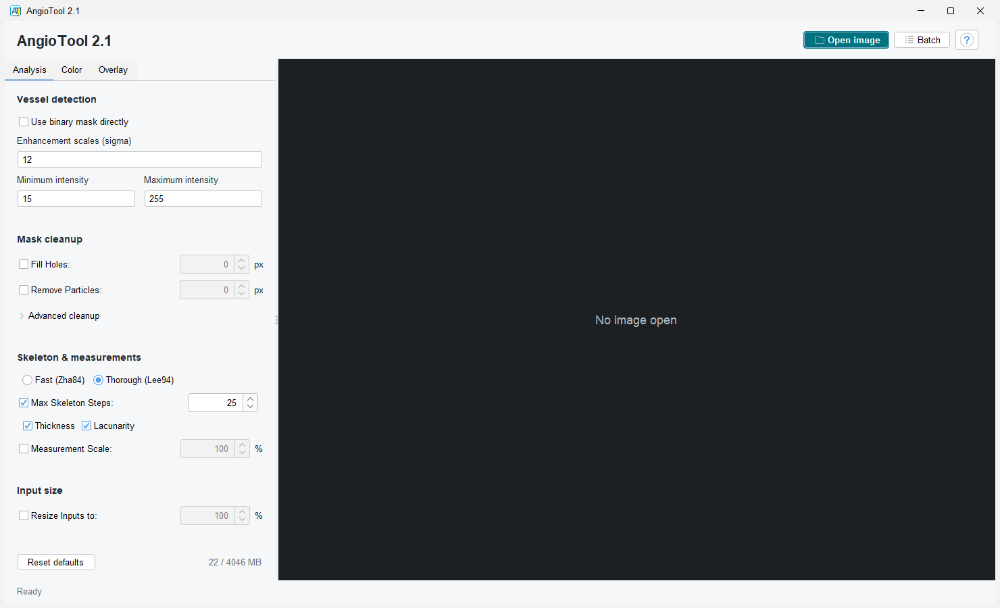
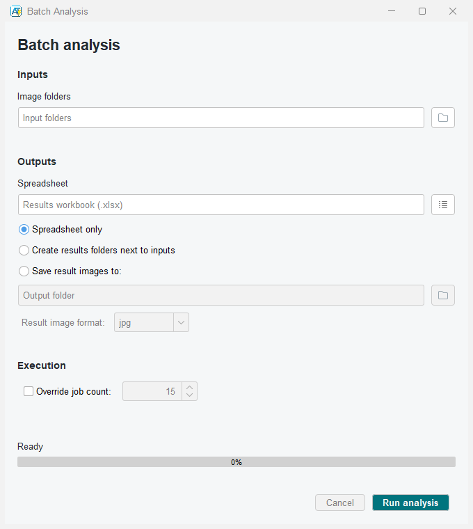
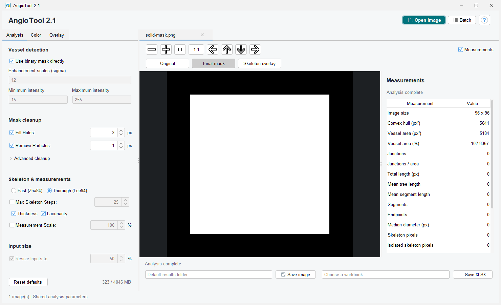

# AngioTool 2.1 UI 现代化

日期：2026-09-07

## 范围

本轮在现有 2.1 修复副本上改造 Swing 界面，保留此前未提交的算法、输出路径和 JSON 修复。初始 UI 改造未改变计算实现；后续按用户要求增加直接二值掩膜输入分支，默认 Tubeness 路径保持不变。参数和图像合并成单窗口工作台，多张图像通过标签切换。保留统一参数及实验性 ImageJ 插件入口。

## 界面

- 主窗口：左侧参数，右侧图像；Open image、Batch、帮助；Analysis / Color / Overlay 参数页；可滚动参数区；高级清理折叠；数值步进控件；参数错误状态；带确认的恢复默认值。
- 图像标签：打开图像不再创建 JFrame。每个标签包含深灰画布、可收起的 Measurements 侧栏、适应窗口、1:1、缩放和平移、保存图像与 XLSX。关闭按钮只关闭对应图像，最后一个标签关闭后回到空工作区。
- 状态归属：分析参数仍统一作用于所有已打开图像；缩放、平移、统计及保存路径分别保留在各图像标签。批处理设置与帮助仍使用工具窗口/对话框。
- 批处理：分离输入、输出和执行设置；图像格式下拉框；并发数步进；固定进度区；长路径悬停查看。
- 主题：浅色 FlatLaf，统一字体、间距和按钮。ImageJ 模式不安装全局 Look and Feel，避免改变宿主外观。
- 控件使用英文，保持与既有参数文档和导出工作流的联系；本轮没有增加国际化系统。






## 实现

- `source/AngioTool/UiTheme.java`：主题、表单分组、滚动、折叠和屏幕边界布局。
- `source/AngioTool/StatisticsPanel.java`：统计展示；区分平均树长度、平均分支长度和中位直径；小数保留科学计数法指数。
- `AngioToolGui2`：管理参数/图像分栏和可关闭标签；递归绑定分组内控件；恢复默认值时抑制中间状态；检查参数后再更新图像。
- `AnalyzerParameters.hasSameAnalysisSettings`：只比较分析输入，不把叠加样式列入重算条件。
- `ImagingWindow`：保留旧类名以缩小改动范围，基类从 JFrame 改为 JPanel，通过 `showInWorkspace()` 嵌入主窗口。样式更新复用 mask 与统计；计算中保留图像；关闭标签时等待计算回调后释放数据；失败恢复控件状态。
- `BatchWindow`：重新排版，关闭窗口请求取消，任务结束后恢复 Run 控件。

XLSX、mask、JSON 文件名与字段保持兼容。统计侧栏是展示层，不参与导出图像像素。

## 依赖

固定依赖：`source/lib/flatlaf-3.6.1.jar`。

SHA-256：

```text
687be33e1e3eface1681fd194732d16e008126a47b6116b4301e7070c918c4c9
```

下载文件与 Maven Central 发布的 SHA-256 已对照一致。既有 `compile.py` 支持合并 `source/lib`，无需更换构建工具。运行时无需联网下载依赖。

Apache 2.0 许可全文保存在 `source/META-INF/licenses/flatlaf-LICENSE.txt`，第三方说明保存在 `source/META-INF/THIRD-PARTY-NOTICES.txt`，均随主 JAR 打包。

## 验证

编译前必须备份当前 JAR。随后运行：

```powershell
python compile.py
javac --release=8 -cp AngioTool2.jar -d build benchmarks/AngioTool/UiSmokeTest.java benchmarks/AngioTool/MetricsParityTest.java benchmarks/AngioTool/AnalysisRegressionTest.java benchmarks/AngioTool/BatchOutputPathTest.java benchmarks/AngioTool/BinaryMaskTest.java benchmarks/AngioTool/FileChooserFontTest.java
java -cp "AngioTool2.jar;build" AngioTool.BinaryMaskTest
java -cp "AngioTool2.jar;build" AngioTool.FileChooserFontTest
java -cp "AngioTool2.jar;build" AngioTool.UiSmokeTest
java "-Dflatlaf.uiScale=1.5" -cp "AngioTool2.jar;build" AngioTool.UiSmokeTest screenshots/ui-2.1-150
java -cp "AngioTool2.jar;build" benchmarks.AngioTool.AnalysisRegressionTest
java -cp "AngioTool2.jar;build" AngioTool.BatchOutputPathTest source/deprecated/images/ImageExample.png
```

`UiSmokeTest` 使用单独的临时 `user.home`，不读写真实用户偏好；保留临时导出目录供检查。其检查包括默认值映射、折叠区域、嵌套控件、输入校验、统计侧栏、样式修改保留 mask 和统计、查看控制、四类导出、连续调参及计算中关闭标签。多图检查确认两张图像嵌入同一个主窗口、切换时保留查看状态、关闭其中一张不影响另一张、最后关闭后恢复空工作区。

`MetricsParityTest` 可分别在旧/新 JAR 类路径下运行，逐行比较所有 `Analyzer.Stats` 字段及 mask 哈希。UI 冒烟截图由实际 Swing 窗口绘制生成，不是设计稿。

已通过：编译、常规及 150% UI 冒烟、算法回归、批处理及示例图像旧/新指标对照。常规截图在 `screenshots/ui-2.1`，150% 截图在 `screenshots/ui-2.1-150`。

最终主 JAR 的 SHA-256：

```text
8d4baf096d421081a19ac172b8eaa19b09aad15bed765b3bd9ad0fbf8a5b3fec
```

此前单窗口版本的打包检查确认主题类、统计组件、FlatLaf 和第三方许可证均存在，并使用 `build/ui-preview-home` 隔离配置启动检查，验证实例已退出。本次字体修复版本通过下述实际 Swing UI 测试，未另行手动启动检查。真实用户偏好没有在测试中改写。

### 文件选择器中文字体修复

主题先前固定使用物理字体 `Segoe UI`，在本机缺少中文字形，导致文件选择器的中文标签和目录名显示为方框。已改为 Java 逻辑字体 `Dialog`，保留字号和 DPI 缩放，并使用平台字形回退。文件选择、引号路径兼容和分析逻辑均未改变。

新增 `benchmarks/AngioTool/FileChooserFontTest.java`，在隔离的临时用户目录和简体中文区域设置下，验证中文图像、多个中文目录、中文 XLSX 保存路径及普通/粗体/斜体字形。修改前已复现缺字断言失败，修改后常规和 150% 测试均通过：

```powershell
javac --release=8 -cp AngioTool2.jar -d build benchmarks/AngioTool/FileChooserFontTest.java
java -cp "AngioTool2.jar;build" AngioTool.FileChooserFontTest
java "-Dflatlaf.uiScale=1.5" -cp "AngioTool2.jar;build" AngioTool.FileChooserFontTest screenshots/file-chooser-font-150
```

同时重新通过常规和 150% `UiSmokeTest`、`AnalysisRegressionTest` 和 `BatchOutputPathTest`。实际 Swing 绘制截图位于 `screenshots/file-chooser-font` 和 `screenshots/file-chooser-font-150`；修复前截图位于 `screenshots/file-chooser-font-before`。

### 图像标签点击修复

自定义标签标题面板接收了鼠标事件，但未将点击用于选择图像，导致打开第二张图后点击第一张标题无法切回。已为标题文字和面板空白处绑定左键选择，按图像组件查找当前标签，避免关闭标签后索引变化；关闭按钮保持独立。

`UiSmokeTest` 原先直接调用 `setSelectedComponent`，未覆盖此交互。现改为派发鼠标按下、释放和点击事件，验证双向标题切换、空白处切换、独立查看状态，以及关闭后台标签后保留当前选择。旧 JAR 已复现首个标题点击断言失败；修复后常规及 150% UI 测试、中文文件选择器测试均通过。本次为 Swing 组件事件测试，未使用系统鼠标自动化。

## 直接二值掩膜模式

`Analysis → Vessel detection → Use binary mask directly` 默认关闭，新增 `AnalyzerParameters.shouldUseBinaryMask`，由现有偏好序列化保存。模式切换参与参数比较并触发重新分析。直接模式接受灰度 0/255 或 0/1；检测到其他像素时报告坐标，不做隐式阈值或自动反色。

`Analyzer.prepareMask` 中的新分支绕过颜色变换、Tubeness、阈值、闭运算及高级清理。后续按用户要求开放独立、默认关闭的去颗粒和填洞选项，详见下节。单图、模式切换重载及批处理使用 `effectiveResizeFactor()`，直接模式固定原始分辨率，避免插值破坏二值边界；退出后恢复原缩放。骨架、测量缩放及叠加逻辑不变。灰显控制仍保留可解析的原设置供切回及保存偏好使用。

单图 XLSX 末尾新增 `Input Mode`；批处理 Settings 同样记录该模式。JSON 增加 `analysisParameters.inputMode`、`useBinaryMask`、`effectiveResizeFactor`，以及 `uiParameters.analysis.useBinaryMask`。已有列、字段和指标计算未重命名。

验证：

- `BinaryMaskTest`：两种骨架器下逐像素保持实心块、真实孔洞、边界点和孤立点；0/1 输入、空掩膜、灰度/彩色拒绝、面积计数、偏好往返、JSON、实际批处理导出均通过。
- `UiSmokeTest`：禁用不适用控件、忽略无效的非活动阈值、保留增强参数、打开缩放图后切入原始尺寸掩膜及切回，正常和 150% 均通过。截图为 `screenshots/ui-2.1/binary-mask.png` 及 `screenshots/ui-2.1-150/binary-mask.png`。
- 中文选择器、算法回归和带真实示例图的批处理输出路径测试通过。
- 使用 `MetricsParityTest` 对照本功能修改前 `AngioTool2-20260907-151235-358-before-compile.jar` 与最终 JAR，示例图的全部 Stats 字段和 mask 哈希完全一致。

新增测试编译时需同时包含 `BinaryMaskTest.java` 和其复用的 `BatchOutputPathTest.java`，运行入口为 `AngioTool.BinaryMaskTest`。未用用户截图对应的原始掩膜验证，也未改变厚块的骨架定义或提供数据集级科学准确性认证。

## 二值清理与对照视图

二值模式的 Fill Holes 和 Remove Particles 使用独立控件与四个持久化字段：`binaryFillHoles`、`binaryHoleRadius`、`binaryRemoveSmallParticles`、`binarySmallParticleRadius`。默认两项关闭，半径分别为 3、15 px；普通模式的原设置不被覆盖。单图 XLSX 末尾及批处理 Settings 增加相应开关/半径列，JSON 同步记录。

去颗粒复用原连通域及面积筛选。新增 `Particles.fillEnclosedHoles` 只填面积不超过 `πr²` 且不接触图像边界的背景连通域；若先去颗粒，会重新标记连通域，避免删除的颗粒被误填回。未修改普通模式的清理规则。

每张图提供 Original / Final mask / Skeleton overlay 视图。显示掩膜使用分析完成后的副本，避免工作线程复用缓冲区时读到中间态。原图按当前分析分辨率显示；各标签独立保留视图，切换不重算、不重置平移缩放。导出和 ImageJ 提交仍使用独立的叠加图缓冲区；分析失败时回到原图，关闭标签释放预览缓冲区。

本次编译、`BinaryMaskTest`、正常与 150% `UiSmokeTest`、中文选择器、算法回归、真实示例批处理均通过。新增检查覆盖独立清理设置、填洞/去颗粒单独及组合效果、超大填洞阈值仍保留外部背景、单个边界背景像素、参数持久化、预览逐像素一致性、清理后预览刷新，以及在掩膜视图下保存仍逐像素等于叠加图。示例图默认模式与 `AngioTool2-20260907-153058-654-before-compile.jar` 的全部 Stats 字段和 mask 哈希完全一致。

截图位于常规及 150% 目录的 `view-original.png`、`view-mask.png`、`binary-cleanup-mask.png`。



## 文档同步

2026-09-07：同步 [README](readme.md)、[中文使用指南](USER_GUIDE_CN.md)、[程序报告](PROGRAM_REPORT_CN.md)、[导出格式](OVERLAY_EXPORT_FORMAT_CN.md) 和 [英文手册源码](source/manual.html)。正文现在区分普通增强与直接掩膜两条路径，说明独立清理、边界保护、视图归属及导出不受预览影响；README 保留上游 2.0 背景，但明确与本地 2.1 区分。

本次文档同步未修改 Java 源码、未重新编译或覆盖 JAR；上方测试结果属于前一轮功能构建。英文手册源码中的旧窗口操作说明已修订，需下次按备份规则构建后才进入 JAR 内置帮助。文档验证限于相对文件链接、JSON 示例/字段核对和差异空白检查。

## 本轮编译备份

以下文件均在项目根目录，复制时禁止覆盖，并通过原文件/备份 SHA-256 一致性检查：

```text
AngioTool2-20260907-142134-126-before-compile.jar
AngioTool2-20260907-142422-724-before-compile.jar
AngioTool2-20260907-143329-891-before-compile.jar
AngioTool2-20260907-143723-106-before-compile.jar
AngioTool2-20260907-143754-315-before-compile.jar
AngioTool2-20260907-144134-849-before-compile.jar
AngioTool2-20260907-145112-507-before-compile.jar
AngioTool2-20260907-145740-450-before-compile.jar
AngioTool2-20260907-151235-358-before-compile.jar
AngioTool2-20260907-151638-745-before-compile.jar
AngioTool2-20260907-153058-654-before-compile.jar
```

首次合并编译发现 XLSX 选择器要求 JFrame，已将其父组件改为主窗口。首次 150% 测试命令被 PowerShell 拆分了 `-Dflatlaf.uiScale=1.5`，用引号包住完整参数后通过。截图检查发现过标题/1:1 文本截断及旧格式化器丢失指数的问题，均已修正后重新验证。

## 回退与限制

- UI 改造前的可运行包：`AngioTool2-20260907-142134-126-before-compile.jar`，已与编译前主 JAR 做 SHA-256 校验。可直接运行此备份，不需要覆盖新包。
- 后续编译另有时间戳备份，不应将中间 UI 版本误认为改造前版本。
- 源码回退仅限本轮 UI 差异，不能对整个工作区执行 reset；目录内有此前未提交的修复。
- 原版与 2.1 仍使用 `%USERPROFILE%\AngioTool2` 偏好目录。本轮保留兼容性，未擅自迁移真实配置。
- 验证环境为本机 JDK 21，目标字节码 Java 8；未单独在 Java 8 运行时或真实 ImageJ/Fiji 宿主中测试。
- 未新增组织 ROI、算法、实验结果准确性认证或数据集级科学验证。ImageJ 插件的实际宿主行为仍需单独验证。
