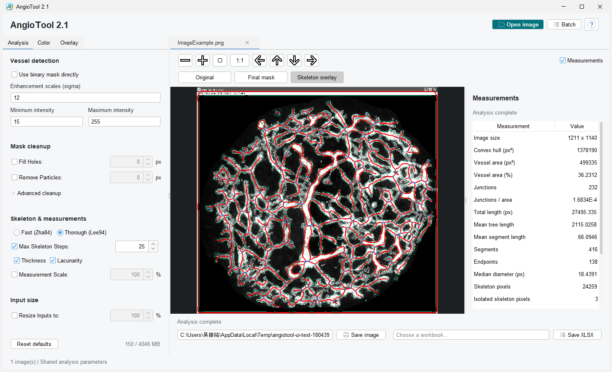

# AngioTool 2.2

## Local 2.2 Update (2026-09-13)

This checkout builds AngioTool 2.2, a local extension of the upstream 2.0
batch edition. It keeps the original Tubeness analysis path and adds:

- a single-window workspace with image tabs and Original, Final mask and
  Skeleton overlay previews;
- direct binary-mask input with independent optional hole filling and particle
  removal settings;
- convergent skeletonization with optional terminal-branch pruning and nearby
  junction merging;
- box-counting fractal dimension for the final vessel mask; and
- optional image-relative normalized JSON/XLSX output.

Binary masks bypass Tubeness and resizing; cleanup is off by default and is
saved separately from normal-mode settings. Invalid or unavailable derived
measurements are reported explicitly in the exports rather than being silently
replaced with zero.

- [Chinese user guide](USER_GUIDE_CN.md): workflows, controls and parameter meanings.
- [Program report](PROGRAM_REPORT_CN.md): architecture and analysis pipelines.
- [Export format](OVERLAY_EXPORT_FORMAT_CN.md): mask, JSON and input-mode metadata.
- [Fractal box-counting guide](FRACTAL_BOX_COUNT_CN.md): method and interpretation.
- [Skeleton 2.2 guide](SKELETON_2.2_CN.md): pruning, junction merging and verification.
- [UI changes and verification](UI_MODERNIZATION_CN.md): screenshots, tests and backups.
- [English manual](source/manual.html).

Build and run locally with:

    python compile.py
    java -jar AngioTool2.2.jar

The build targets Java 8. Before each rebuild, preserve any existing legacy
`AngioTool2.jar` in a unique timestamped backup and verify the copy, as required
by [AGENTS.md](AGENTS.md).

## Upstream 2.0 Background

The description and release link below refer to the upstream project, not
the locally modified 2.2 build.

This is a rewritten version of AngioTool, which features advanced analysis settings and batch processing.

AngioTool is a program designed to analyse eye scans for potential defects,
using various algorithms to extract data from the scanned image.
It was developed by the Center for Cancer Research from 2011-2014, and is commonly used in the ophthalmology field.

The intended use case was to view and analyse a scanned image, while also saving the results for record keeping and further analysis.
However, in ophthalmology research, it is also used to process large collections of scans.
Since AngioTool only lets the user analyse one scan at a time, this process becomes extremely tedious,
especially when the scanning settings don't need to change.

This version of AngioTool lets the user select one or more folders,
which are recursed fully such that every single non-output image inside those folders
(and the folders inside those folders, and so on) are analysed all in go.
The settings as specified in the user interface are applied to each scan.

Additional settings were also implemented, for example the "Transform Colors" feature which allows for colour OCT scans to be properly analysed.
See the [manual](source/manual.html) for more details.

To download binaries, check the [Releases](https://github.com/jbendtsen/AngioTool-Batch/releases) tab.

The upstream version can be run either as a standalone program or as a plugin
inside ImageJ. ImageJ support remains experimental; for this local 2.2 build,
use the standalone JAR command shown above.
